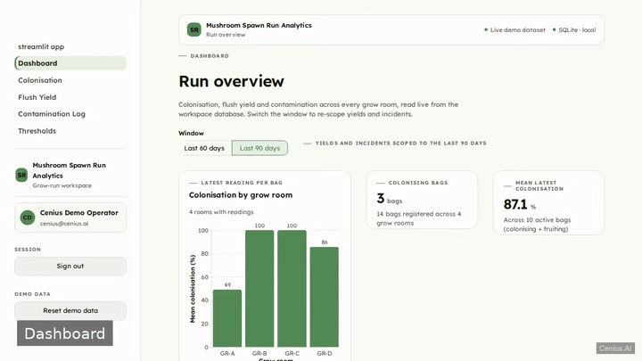
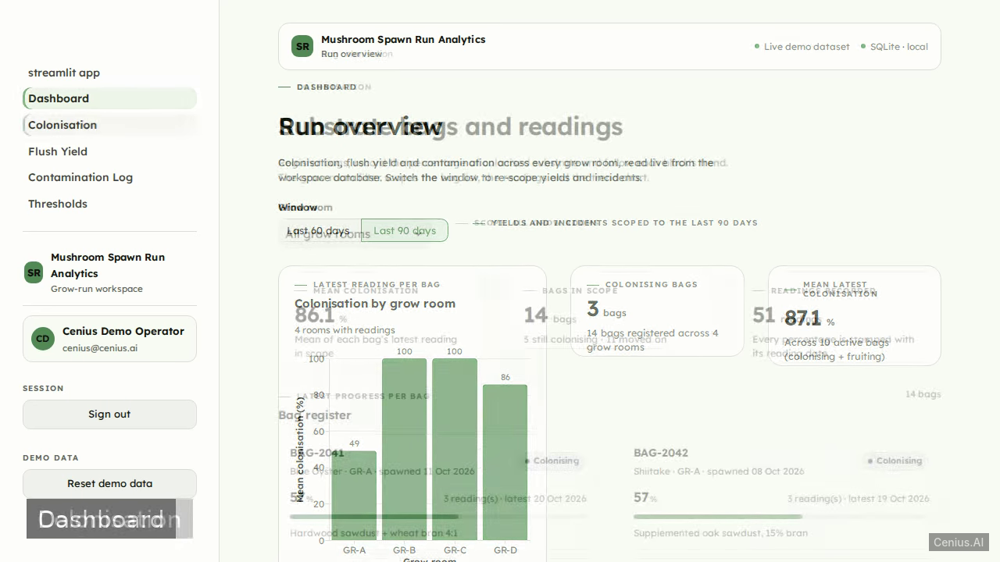
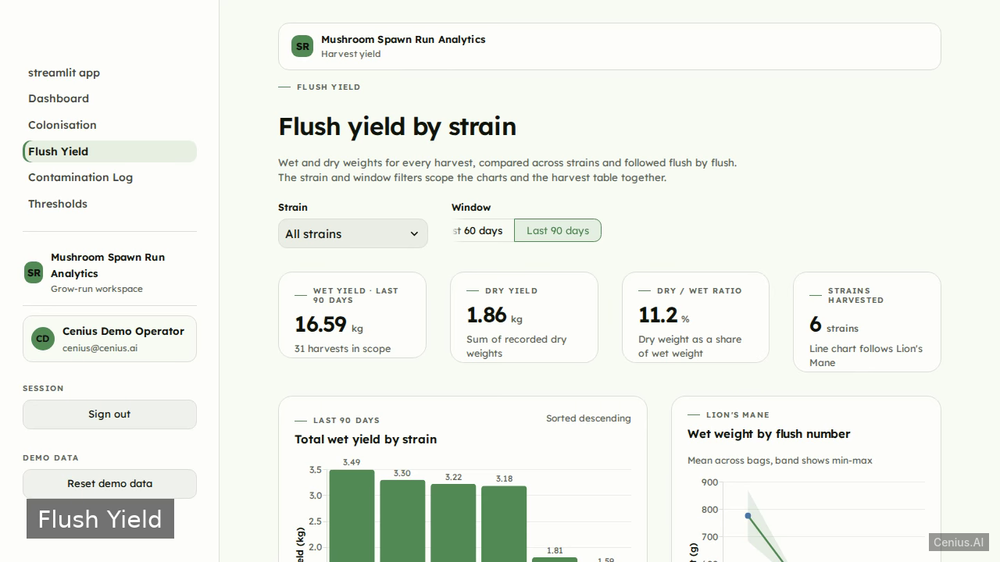

# Mushroom Spawn Run Analytics — complete Full-stack app monitoring dashboard example app

This repository contains the complete source for **Mushroom Spawn Run Analytics**, an open-source monitoring dashboard built with Full-stack app. A local, production-quality Streamlit multi-page data app for a mushroom farm's spawn run. Everything Mushroom Spawn Run Analytics needs to run is here — code, seed data, install scripts. Apache-2.0-licensed — use Mushroom Spawn Run Analytics commercially, self-host it, or [remix Mushroom Spawn Run Analytics on cenius.ai](https://cenius.ai/marketplace/p/mushroom-spawn-run-analytics?ref=gh&utm_campaign=mushroom-spawn-run-analytics-webapp) to make it yours.


[](LICENSE)  [](https://cenius.ai)

[](https://cenius.ai/marketplace/p/mushroom-spawn-run-analytics?ref=gh&utm_campaign=mushroom-spawn-run-analytics-webapp)

> **▶ [Open & edit in cenius.ai](https://cenius.ai/marketplace/p/mushroom-spawn-run-analytics?ref=gh&utm_campaign=mushroom-spawn-run-analytics-webapp)** — one click to an editable workspace: describe changes in plain English, get an instant preview, one-click deploy and host. Modifications made on the platform come with full rebrand & relicense rights.

_Local clone? See [Quick start](#quick-start) below. cenius.ai is the zero-setup path._

## Demo



▶ **[Video walkthrough](https://cenius.ai/marketplace/p/mushroom-spawn-run-analytics?ref=gh&utm_campaign=mushroom-spawn-run-analytics-webapp)** — see the app in action on the cenius.ai project page · [MP4 file](.github/media/demo.mp4)

## Screenshots

  

## Architecture

Full-stack app project, delivered as a complete runnable codebase (42 files). Top-level layout: `core/`, `data/`, `pages/`, `static/`, `tests/`. Run `./install.sh` once to install packages and populate demo data — the app is ready to use immediately after. Step-by-step setup guide: [`INSTALL.md`](INSTALL.md).

## Features

- Local sign-in gate
- Substrate bag colonisation per grow room
- Flush yield charts by strain
- Contamination incident log
- Humidity and CO2 threshold table
- Seeded demo dataset and reset

## Quick start

```bash
./install.sh   # installs dependencies + seeds demo data
```

See [`INSTALL.md`](INSTALL.md) for full setup and usage instructions.

## Usage guide

Sign in with `cenius@cenius.ai` / `cenius` (or click **Use demo credentials**). Every
page is seeded, so nothing needs to be entered before the app is useful.

### Dashboard (`/Dashboard`)

The home screen answers "how is the current run going?" in one glance.

- **Colonising bags** — how many bags are still colonising, against the 14 registered.
- **Mean latest colonisation** — the mean of each active bag's most recent reading.
- **Wet yield · last N days** — total wet weight harvested in the selected window, with a
  delta against the previous window of the same length.
- **Open incidents** — incidents still awaiting a resolution, plus how many are high severity.
- The window selector (**Last 30 / 60 / 90 days**) re-scopes the yield and incident charts.
- **Humidity and CO2 thresholds** strip shows each room's configured range; the link jumps
  to the threshold editor.

### Colonisation (`/Colonisation`)

- Pick a grow room (or *All grow rooms*) to scope the bag cards, the mean figure and the
  trend chart.
- Each bag card shows its strain, room, spawn date, status chip, latest percentage and a
  progress bar.
- Select a bag under **Colonisation trend** to see every reading plotted by date.
- **Record a reading**: choose the bag, the reading date, a percentage between 0 and 100 and
  optional notes. The bag's latest percentage and progress bar update immediately.
- **Register a bag**: bag code, room, strain, substrate recipe, spawn date and a status
  limited to Colonising / Fruiting / Contaminated / Retired (defaults to Colonising).

_Full guide: [`USAGE.md`](USAGE.md)_

## FAQ

### What's the quickest way to self-host Mushroom Spawn Run Analytics?

Clone this repository and run `./install.sh`, then start the app as described in [`INSTALL.md`](INSTALL.md). Mushroom Spawn Run Analytics is fully self-hostable — no external services are required to try it.

### Can I rebrand or white-label Mushroom Spawn Run Analytics?

Rebranding is straightforward under the MIT license — change what you want in the source. Or [open it on cenius.ai](https://cenius.ai/marketplace/p/mushroom-spawn-run-analytics?ref=gh&utm_campaign=mushroom-spawn-run-analytics-webapp): the platform handles the changes and grants full rebrand rights on the result.

### Is it OK to ship Mushroom Spawn Run Analytics as part of a product?

Yes. The code is Apache-2.0-licensed — use it, modify it, and ship it commercially. See [LICENSE](LICENSE).

### What is Mushroom Spawn Run Analytics built with?

Full-stack app end-to-end. Every file you need to run the app is here in this repository — code, configuration, seed data. Highlights include seeded demo dataset and reset.

### Is Mushroom Spawn Run Analytics editable without a developer?

[cenius.ai](https://cenius.ai/marketplace/p/mushroom-spawn-run-analytics?ref=gh&utm_campaign=mushroom-spawn-run-analytics-webapp) handles the implementation. Tell it what you want in everyday words, pick up the updated build. No coding needed.

## License & rebranding

Released under the [Apache License 2.0](LICENSE) (© 2026 Cenius AI) — free for personal and commercial use. The Cenius name/logo are trademarks (see NOTICE).

**Need a customized version?** [Remix this app on cenius.ai](https://cenius.ai/marketplace/p/mushroom-spawn-run-analytics?ref=gh&utm_campaign=mushroom-spawn-run-analytics-webapp) — modifications made on the platform come with **full rebrand & relicense rights** over your derivative.

## Built with cenius.ai

This entire application — code, design, seeded demo data — was generated on **[cenius.ai](https://cenius.ai)** from a plain-English description.

- 🚀 [Build your own app on cenius.ai](https://cenius.ai)
- 🎛️ [Remix Mushroom Spawn Run Analytics on the marketplace](https://cenius.ai/marketplace/p/mushroom-spawn-run-analytics?ref=gh&utm_campaign=mushroom-spawn-run-analytics-webapp) — open it in a workspace, prompt for changes, and ship your own version.

More open-source apps: [the Cenius-ai catalog](https://github.com/Cenius-ai) · [showcase index](https://github.com/Cenius-ai/showcase)
